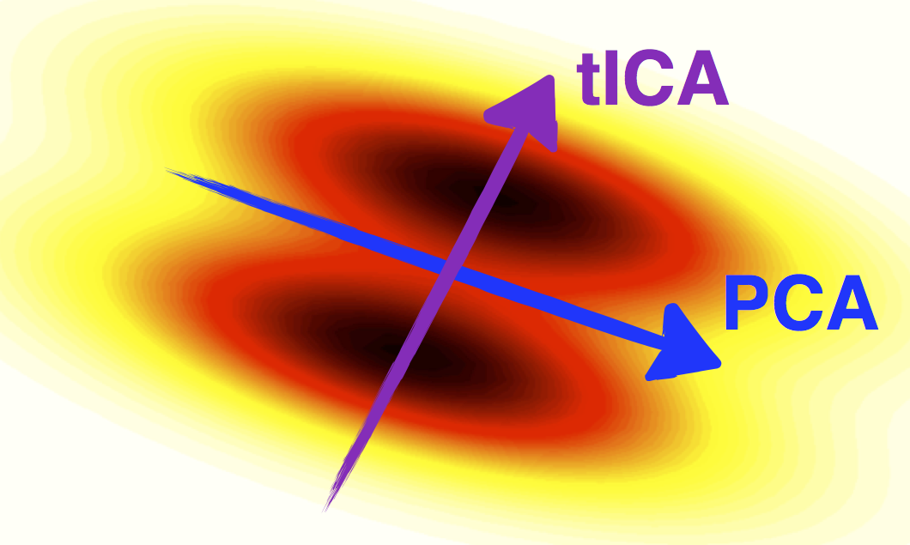

.. _decomposition:
.. currentmodule:: msmbuilder.decomposition

Decomposition
=============

tICA
----

   tICA compared to PCA (courtesy of C. R. Schwantes)

Time-structure independent components analysis (tICA) is a method for
finding the slowest-relaxing degrees of freedom in a time series data set
which can be formed from linear combinations from a set of input degrees of
freedom.

tICA can be used as a dimensionality reduction method and, in that capacity,
is somewhat similar to PCA.  However whereas PCA finds high-variance
linear combinations of the input degrees of freedom, tICA finds
high-autocorrelation linear combinations of the input degrees of freedom.

The tICA method has one obvious drawback: its solution is
a linear combination of all input degrees of freedom, and their
relative weights are typically non-zero. This makes each independent component
difficult to interpret in an algorithmic fashion because
it could comprise hundreds or thousands of different metrics.
Because an important property of reaction coordinates is their
role in facilitating physical interpretation of the underlying molecular
system, we consider it desirable to reduce the number of
explicitly used variables. SparseTICA [#f2]_ attempts to resolve this
interpretability issue by using a sparse approximation to
the eigenvalue problem found in tICA and returning independent components
composed of only the most relevant degrees of freedom.

Another limitation of tICA is that it is constrained to finding linear
correlations between input coordinates. The KernelTICA method [#f5]_
provides a natural extension to nonlinear functions by utilizing the kernel
trick and represents a substantial improvement in estimating the
eigenfunctions of the transfer operator directly.

VAMP
----

The variational approach for Markov processes (VAMP) [#f6]_ generalizes tICA to
dynamics that are not reversible or not at equilibrium, such as driven systems,
data from short trajectories started out of equilibrium, or non-stationary
processes. It finds the linear combinations of input features that best
approximate the dominant *singular* functions of the Koopman (transfer)
operator, rather than its eigenfunctions.

VAMP also provides a score that is valid without assuming reversibility. The
VAMP-2 score is one plus the sum of the squared singular values, and it can be
evaluated on held-out data, so it can rank featurizations, lag times and
numbers of components by cross-validation, in the same way GMRQ does for
reversible models (see :ref:`gmrq`). VAMP-1 and VAMP-E scores are also
available through ``score_method``.

.. code-block:: python

    from msmbuilder.decomposition import VAMP

    vamp = VAMP(n_components=5, lag_time=10)
    projected = vamp.fit_transform(train_features)
    print(vamp.singular_values_, vamp.score_)
    test_score = vamp.score(test_features)   # VAMP-2 on held-out data

For reversible, equilibrium data the VAMP singular values and tICA eigenvalues
estimate the same quantities. The implementation follows the definitions used
by deeptime [#f7]_, and its tests check it against deeptime.

Deep learning (optional)
------------------------

Five neural-network estimators learn collective variables that are
nonlinear functions of the input features. They need PyTorch
(``pip install msmbuilder-neo[torch]``) and follow the same API as the other
decomposition methods, so they work in pipelines and cross-validation.

* :class:`VAMPNet` [#f8]_ trains a network to maximize a VAMP score of its
  outputs. With ``output='softmax'`` the outputs are probabilities of soft
  metastable states; with ``'linear'`` they are unconstrained slow variables.
* :class:`SRV`, the state-free reversible VAMPnet [#f9]_, maximizes the
  reversible VAMP-2 score and returns the learned eigenfunctions in order,
  with ``eigenvalues_`` and ``timescales_``, like a nonlinear tICA.
* :class:`TimeLaggedAutoencoder` [#f10]_ compresses x(t) through a bottleneck
  and is trained to predict x(t + lag); ``transform`` returns the bottleneck.
* :class:`DeepTICA` [#f11]_ trains a network so that TICA of its outputs has
  the largest eigenvalues, and returns the slowest TICA projections. It can
  learn from biased simulations (metadynamics, OPES): pass per-frame
  ``logweights`` (typically ``beta * bias``) to ``fit``, and pairs are then
  found in the rescaled time, as in [#f11]_.
* :class:`DeepLDA` [#f12]_ is supervised: from frames labelled by state (for
  example short runs in each metastable state) it learns the projections that
  best separate the states. ``fit(sequences, y)`` takes one label per
  sequence, or one per frame.

DeepTICA and DeepLDA use the definitions of the mlcolvar package [#f13]_
(losses, regularizations, output normalization and reweighting); the test
suite checks them against mlcolvar, which is not needed to use them.

.. code-block:: python

    from msmbuilder.decomposition import SRV

    srv = SRV(n_components=2, lag_time=10, hidden_layers=(64, 64),
              n_epochs=50, random_state=0)
    slow_coordinates = srv.fit_transform(train_features)
    print(srv.timescales_)
    print(srv.score(test_features))    # VAMP-2 on held-out data

For the unsupervised estimators, ``score`` fits a linear VAMP model to the
training embedding and returns its VAMP-2 score on the embedding of new data,
so architectures, lag times and estimators can be compared on the same scale
(for DeepLDA, ``score(sequences, y)`` measures how well labelled states are
separated). Set ``random_state`` for reproducible fits, and ``device='cuda'``
(or ``'mps'``) to train on a GPU.

Every fitted network can be saved as TorchScript, with the input
standardization and output rotation built in, to bias the learned collective
variables in PLUMED with its ``PYTORCH_MODEL`` action:

.. code-block:: python

    from msmbuilder.decomposition import DeepTICA

    cv = DeepTICA(n_components=1, lag_time=5, hidden_layers=(30, 30))
    cv.fit(features, logweights=[beta * bias for bias in biases])
    cv.to_torchscript("deeptica.ptc")

PLUMED must compute the same input features, in the same order.

PCA
---

Principal component analysis (PCA) is a method for finding the most
highly varying degrees of freedom in a data set (not necessarily a time
series). PCA is useful as a dimensionality reduction method.

Algorithms
----------

.. autosummary::

    tICA
    VAMP
    VAMPNet
    SRV
    TimeLaggedAutoencoder
    DeepTICA
    DeepLDA
    SparseTICA
    PCA

Theory
------

PCA
~~~

PCA tries to find projection vectors that maximize their
explained variance, subject to them being uncorrelated and having length
one. In the end, these maximal variance projections correspond to the
solutions of the following eigenvalue problem:

.. math:: \Sigma v = \lambda v

where :math:`\Sigma` is the covariance matrix given by:

.. math:: \Sigma_{ij} = \mathbb{E}\Big[ X_i(t) X_j(t) \Big]

The problem with using PCA to define a reduced space for biomolecular
dynamics, however, is
that high-variance degrees of freedom need not be slow (for instance
consider a floppy protein tail that varies wildly vs. a single dihedral
angle that is required to rotate for a protein to fold). What we really
want is to design projections that can best differentiate between slowly
equilibrating populations, which is precisely where tICA comes in.

tICA
~~~~

In tICA, the goal is to find projection vectors that maximize their
autocorrelation function, subject to them being uncorrelated and having
unit variance. It is easy to show [#f1]_ that the solution to the tICA
problem are the solutions to this generalized eigenvalue problem (which is
closely related to the PCA eigenvalue problem):

.. math:: C^{(\Delta t)} v = \lambda \Sigma v

where :math:`C^{(\Delta t)}` is the time lag correlation matrix defined
by:

.. math:: C^{(\Delta t)}_{ij} = \mathbb{E}\Big[ X_i(t) X_j(t+\Delta t) \Big]

Given this solution, we can use the tICA method to define a reduced
dimensionality representation of each :math:`\mathbf{X}(t)` by
projecting the vector onto the slowest :math:`n` tICs.

Hyperparameters
~~~~~~~~~~~~~~~

There are two parameters introduced in the tICA method. The first is
:math:`\Delta t`, which is used in the calculation of the time-lag
correlation matrix (:math:`C^{(\Delta t)}`). The second is :math:`n`,
which is the number of tICs to project onto when calculating distances
between conformations. You can use :ref:`the GMRQ score<gmrq>` to choose
these parameters. Typical values are of order nanoseconds and tens,
respectively.

Drawbacks
~~~~~~~~~

Since part of the process of using tICA is a dimensionality reduction,
there is always the opportunity to throw out important pieces of
information. By throwing out the faster degrees of freedom, we can better
estimate the slowest timescales; but this comes with the trade-off of not
representing the fast timescales correctly.

Combination with MSM
--------------------

While the tICs are themselves approximations to the dominant eigenfunctions
of the propagator / transfer operator, the approach taken in [#f1]_ and
[#f2]_ is to "stack" tICA with :ref:`MSMs<msm>`. For example, in [#f2]_,
Perez-Hernandez et al.  first measured the 66 atom-atom distances between a
set of atoms in each frame of their MD trajectories, and then used tICA to
find the slowest 1, 4, and 10 linear combinations of these degrees of
freedom and transform the 66-dimensional dataset into a 1, 4, or
10-dimensional dataset. Then, they applied
:class:`~msmbuilder.cluster.KMeans` to the resulting data and built an MSM.

.. todo: Link to example notebook.

References
----------

.. [#f1] Schwantes, Christian R., and Vijay S. Pande. `Improvements in Markov State Model Construction Reveal Many Non-Native Interactions in the Folding of NTL9 <http://dx.doi.org/10.1021/ct300878a>`_ J. Chem Theory Comput. 9.4 (2013): 2000-2009.
.. [#f2] Perez-Hernandez, Guillermo, et al. `Identification of slow molecular order parameters for Markov model construction <http://dx.doi.org/10.1063/1.4811489>`_ J Chem. Phys (2013): 015102.
.. [#f3] Naritomi, Yusuke, and Sotaro Fuchigami. `Slow dynamics in protein fluctuations revealed by time-structure based independent component analysis: The case of domain motions <http://dx.doi.org/10.1063/1.3554380>`_ J. Chem. Phys. 134.6 (2011): 065101.
.. [#f4] McGibbon, R. T. & Pande, V. S. `Identification of simple reaction coordinates from complex dynamics <http://arxiv.org/abs/1602.08776>`_ ArXiv 16 (2016).
.. [#f5] Schwantes, Christian R., and Vijay S. Pande. `Modeling Molecular Kinetics with tICA and the Kernel Trick <http://dx.doi.org/10.1021/ct5007357>`_ J. Chem Theory Comput. 11.2 (2015): 600–608.
.. [#f6] Wu, Hao, and Frank Noé. Variational approach for learning Markov processes from time series data. J. Nonlinear Sci. 30 (2020): 23–66.
.. [#f7] Hoffmann, Moritz, et al. Deeptime: a Python library for machine learning dynamical models from time series data. Mach. Learn.: Sci. Technol. 3 (2022): 015009.
.. [#f8] Mardt, Andreas, et al. VAMPnets for deep learning of molecular kinetics. Nat. Commun. 9 (2018): 5.
.. [#f9] Chen, Wei, Hythem Sidky, and Andrew L. Ferguson. Nonlinear discovery of slow molecular modes using state-free reversible VAMPnets. J. Chem. Phys. 150 (2019): 214114.
.. [#f10] Wehmeyer, Christoph, and Frank Noé. Time-lagged autoencoders: Deep learning of slow collective variables for molecular kinetics. J. Chem. Phys. 148 (2018): 241703.
.. [#f11] Bonati, Luigi, GiovanniMaria Piccini, and Michele Parrinello. Deep learning the slow modes for rare events sampling. Proc. Natl. Acad. Sci. USA 118 (2021): e2113533118.
.. [#f12] Bonati, Luigi, Valerio Rizzi, and Michele Parrinello. Data-driven collective variables for enhanced sampling. J. Phys. Chem. Lett. 11 (2020): 2998-3004.
.. [#f13] Bonati, Luigi, Enrico Trizio, Andrea Rizzi, and Michele Parrinello. A unified framework for machine learning collective variables for enhanced sampling simulations: mlcolvar. J. Chem. Phys. 159 (2023): 014801.

.. vim: tw=75
