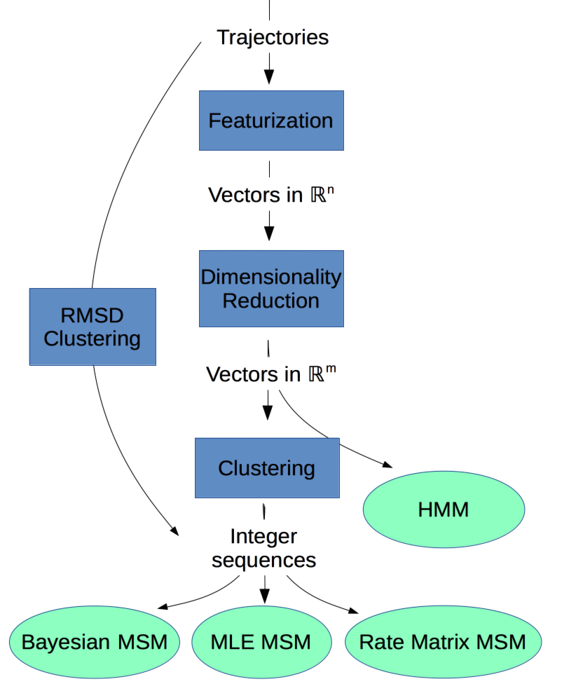

.. _user_guide:

User guide
==========

An MSMBuilder analysis is a chain of scikit-learn style estimators that each
take a *list* of time series: features are computed from trajectories,
reduced to a few slow coordinates, clustered into states, and modeled with a
Markov state model, which is then validated and interpreted.

.. toctree::
   :maxdepth: 1
   :caption: Building a model

   featurization
   feature_selection
   preprocessing
   decomposition
   cluster
   msm
   hmm
   ratematrix

.. toctree::
   :maxdepth: 1
   :caption: Validating and interpreting

   gmrq
   tpt

.. toctree::
   :maxdepth: 1
   :caption: Workflows and data

   pipeline
   apipatterns
   datasets
   io
   plugins
